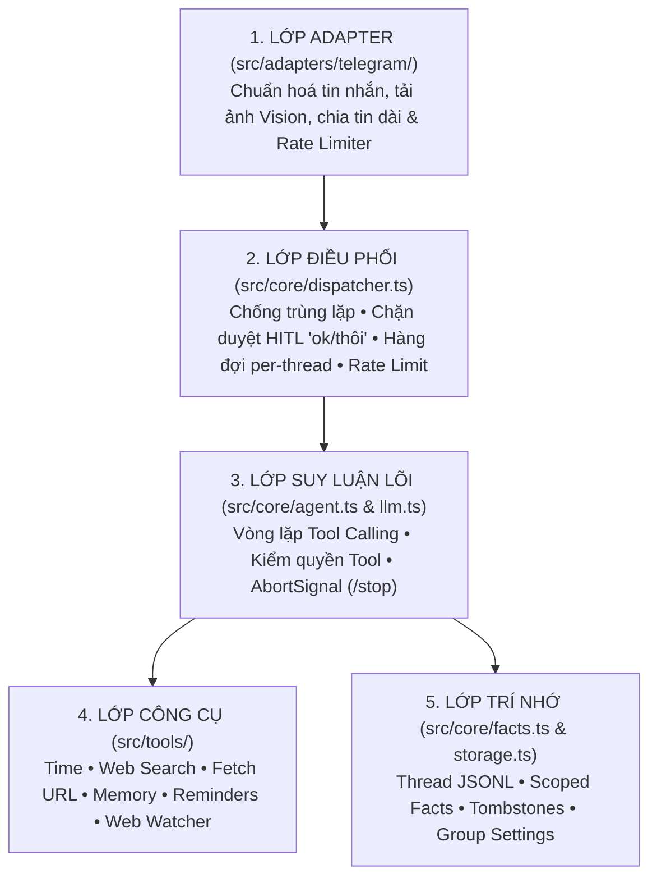

# 🤖 Bekane Bot — Telegram AI Agent Đa Năng & Chuyên Sâu

> **Tác giả / Chủ sở hữu:** **Phùng Hữu Luân** (`@bekane_bot`)  
> **Repository:** [github.com/luan0217091310-gif/setup-bot-tele](https://github.com/luan0217091310-gif/setup-bot-tele)  
> **Kiến trúc:** 5-Layer Industrial AI Agent (TypeScript • Node.js >=22 • `node-telegram-bot-api` v2 • OpenAI / Google Gemini Multimodal SDK • `vitest`)

**Bekane Bot** không phải là một chatbot hỏi-đáp kịch bản thông thường, mà là một **AI Agent cá nhân & trợ lý nhóm có nhận thức, thị giác máy tính (Multimodal Vision), hệ thống trí nhớ phân tầng và vòng lặp tự chủ gọi công cụ (Tool-Calling Agentic Loop)**.

---

## ✨ Tính năng nổi bật

### 1. 🖼️ Thị giác AI: Xem, Phân tích & Đánh giá Hình ảnh (Multimodal Vision)
- **Gửi ảnh trực tiếp** (có hoặc không kèm chú thích) hoặc **Reply (trả lời) vào bất kỳ bức ảnh nào** trong đoạn chat để nhờ bot xem và phân tích.
- **Đánh giá chuyên sâu:** Nhận xét bố cục, ánh sáng, màu sắc, thẩm mỹ ảnh chụp, đọc chữ trong ảnh (OCR), giải bài tập, review giao diện code/thiết kế, hoặc bình luận meme hài hước như một người bạn thân.

### 2. 🛠️ Vòng lặp Suy luận & 11 Công cụ Tự chủ (Agentic Tool Calling)
Bot tự động suy luận và kết hợp các công cụ trong tối đa `MAX_ROUNDS` bước mỗi lượt:

| Công cụ (Tool) | Quyền hạn | Chức năng chi tiết |
| :--- | :---: | :--- |
| `get_current_time` | Public | Lấy chính xác thứ, ngày, tháng, năm và giờ Việt Nam (`Asia/Ho_Chi_Minh`). |
| `web_search` | Public | Tìm kiếm Internet thời gian thực (hỗ trợ **Tavily API** có RAM cache 10 phút + **chế độ tìm kiếm tự động không cần API key** qua DuckDuckGo). |
| `fetch_url` | Public | Đọc và tóm tắt nội dung chi tiết bài báo/website từ link người dùng gửi (tích hợp `safeFetch` chống tấn công mạng nội bộ SSRF). |
| `remember_fact` | Public | Ghi nhớ dài hạn sở thích, thói quen, kỷ niệm của Phùng Hữu Luân và các thành viên; hỗ trợ đính chính thông tin cũ (`replacesId`). |
| `forget_fact` | **Admin (HITL)** | Xoá ghi nhớ theo ID — bắt buộc tạm dừng chờ Admin gõ xác nhận **`ok`** hoặc **`thôi`**. |
| `schedule_reminder` | Public | Đặt lịch hẹn giờ nhắc việc chủ động trên Telegram (ví dụ: *"Nhắc mình 15 phút nữa đi uống nước"*). |
| `list_reminders` | Public | Xem danh sách các lịch hẹn nhắc việc đang chờ trong cuộc trò chuyện. |
| `cancel_reminder` | Public | Huỷ lịch hẹn nhắc việc theo mã ID. |
| `watch_url` | **Admin** | Giám sát thay đổi của một trang web định kỳ bằng **Clean Text SHA-256 Hash** (tốn 0 token AI khi trang không đổi; tự báo về Telegram khi trang có cập nhật mới). |
| `list_watches` | Public | Xem danh sách các website đang được giám sát. |
| `unwatch_url` | **Admin** | Ngừng giám sát một website theo mã ID. |

### 3. 🧠 Trí nhớ Phân tầng & Chống rò rỉ Dữ liệu (Hierarchical Scoped Memory)
- **Lịch sử hội thoại theo từng Chat/Topic (`data/threads/<chatId>[_<topicId>]/history.jsonl`):** Ghi file an toàn (atomic write-then-rename), tách biệt tuyệt đối giữa chat riêng, các nhóm và từng topic.
- **Chống rò rỉ DM ra Nhóm (`Collection-Time Visibility`):** Thông tin tâm sự trong chat riêng (DM) được gắn cứng `visibility: 'private'` bằng code, không bao giờ lọt vào ngữ cảnh của bất kỳ nhóm chat nào.
- **Độ tươi mới & Đính chính (`Staleness & Tombstones`):** Tự động gắn nhãn `(cũ, cần hỏi lại)` cho thông tin quá 90 ngày (hoặc 14 ngày với thông tin biến động `volatile`), và lưu danh sách `Tombstones` để bot không nhắc lại thông tin đã được đính chính.

### 4. 🛡️ Bảo mật, Phân quyền & Duyệt thao tác (Guardrails & HITL)
- **Phân quyền bằng ID định danh (`ADMIN_TELEGRAM_IDS`):** So khớp tuyệt đối bằng `senderId` số của Telegram — kẻ lạ đổi tên hiển thị giống Admin vẫn bị chặn hoàn toàn.
- **Ẩn và chặn Tool Admin ở cấp độ lõi:** Thành viên thường không nhìn thấy công cụ Admin trong schema và bị chặn cứng nếu model cố tình gọi.
- **Human-in-the-Loop (`ok` / `thôi`):** Các thao tác xoá dữ liệu nhạy cảm tự động dừng lại hỏi xác nhận của chủ bot trước khi thực thi.
- **Lọc bí mật đầu ra (`Redaction`):** Tự động quét và ẩn mọi Token Telegram, API Key (OpenAI, Gemini `AIza...` / `AQ...`, Tavily), Bearer token và mật khẩu trước khi gửi ra chat hoặc ghi log.

---

## 🏗️ Kiến trúc 5 Lớp Chuẩn Công Nghiệp



---

## 🚀 Hướng dẫn Cài đặt & Chạy từ A–Z

### Bước 1: Yêu cầu hệ thống
- **Node.js `>= 22`** (kiểm tra bằng lệnh `node -v`).
- Một tài khoản **Telegram** và một khóa API từ **Google AI Studio (Gemini)** hoặc **OpenAI**.

### Bước 2: Tạo Bot trên Telegram (`@BotFather`)
1. Mở Telegram, nhắn tin cho **[@BotFather](https://t.me/BotFather)** (có dấu tích xanh).
2. Gửi lệnh `/newbot` → nhập **Tên hiển thị** → nhập **Username** cho bot (kết thúc bằng `bot`, ví dụ: `bekane_bot`).
3. Lưu lại **HTTP API Token** và **Username** của bot.
4. **Tắt Privacy Mode** để bot đọc được tin nhắn trong nhóm:
   - Gửi `/setprivacy` cho `@BotFather` → chọn `@bekane_bot` → chọn **`Disable`**.
   - *(Lưu ý: Nếu đã thêm bot vào nhóm trước khi Disable, hãy xóa bot khỏi nhóm rồi thêm lại).*
5. **Lấy User ID Telegram của bạn:**
   - Tìm bot `@userinfobot` trên Telegram → bấm **Start** → copy dãy số **`Id`** (ví dụ: `6864517458`).

### Bước 3: Lấy khóa API AI (Google Gemini hoặc OpenAI)
- **Khuyên dùng Google Gemini (Miễn phí / Tốc độ cao / Hỗ trợ xem ảnh cực tốt):**
  1. Truy cập [Google AI Studio (aistudio.google.com/api-keys)](https://aistudio.google.com/api-keys).
  2. Bấm **Create API key** → copy mã khóa.
  3. Cấu hình trong `.env`:
     ```dotenv
     AI_BASE_URL=https://generativelanguage.googleapis.com/v1beta/openai/
     AI_API_KEY=khoa_api_gemini_cua_ban
     AI_MODEL=gemini-3.1-flash-lite
     ```
- **Hoặc dùng OpenAI:**
  ```dotenv
  AI_BASE_URL=https://api.openai.com/v1
  AI_API_KEY=sk-...
  AI_MODEL=gpt-4o-mini
  ```

### Bước 4: Clone dự án & Cài đặt thư viện

```powershell
git clone https://github.com/luan0217091310-gif/setup-bot-tele.git
cd setup-bot-tele
npm.cmd ci
```

Tạo file `.env` từ file mẫu `.env.example`:

```powershell
if (-not (Test-Path -LiteralPath .env)) { Copy-Item -LiteralPath .env.example -Destination .env }
```

Mở file `.env` và điền các thông số của bạn:

```dotenv
TELEGRAM_BOT_TOKEN=token_tu_BotFather
TELEGRAM_BOT_USERNAME=bekane_bot
BOT_ALIASES=bekane,luanbot
ADMIN_TELEGRAM_IDS=6864517458
ALLOWED_GROUPS=-5185817080
DM_POLICY=admin
GROUP_REPLY_MODE=all

AI_BASE_URL=https://generativelanguage.googleapis.com/v1beta/openai/
AI_API_KEY=khoa_api_cua_ban
AI_MODEL=gemini-3.1-flash-lite
MAX_ROUNDS=5
MAX_OUTPUT_TOKENS=1500
```

> **Mẹo lấy `ALLOWED_GROUPS` cho nhóm mới:** Bạn có thể để `ALLOWED_GROUPS=` trống ở lần chạy đầu, thêm bot vào nhóm rồi dùng tài khoản Admin gõ `/id@ten_bot` trong nhóm. Bot sẽ trả về `Chat ID: -100...` (hoặc `-...`), bạn chỉ cần dán mã số âm đó vào `ALLOWED_GROUPS` rồi khởi động lại bot.

### Bước 5: Chạy Bot & Kiểm thử

- **Chạy chế độ phát triển (tự nạp TypeScript trực tiếp):**
  ```powershell
  npm.cmd run dev
  ```
- **Chạy bộ kiểm thử tự động (71 bài test an toàn & tích hợp):**
  ```powershell
  npm.cmd test
  npm.cmd run typecheck
  npm.cmd run build
  ```
- **Chạy bản Production đã biên dịch:**
  ```powershell
  npm.cmd start
  ```

### Bước 6: Tự động chạy ngầm khi bật máy Windows (Auto-start)
Dự án đã tích hợp sẵn bộ script chạy ngầm không hiện cửa sổ CMD và tự khởi động lại nếu mất mạng:
- **Cài đặt tự động bật cùng Windows:**
  ```powershell
  npm.cmd run build
  powershell -ExecutionPolicy Bypass -File scripts/install-autostart.ps1
  ```
- **Bật bot chạy ngầm ngay lập tức:**
  ```powershell
  wscript.exe scripts/start-hidden.vbs
  ```
- **Dừng bot chạy ngầm:**
  ```powershell
  powershell -ExecutionPolicy Bypass -File scripts/stop-bot.ps1
  ```
- Xem nhật ký chạy ngầm tại `data/bot.log` và `data/supervisor.log`.

---

## 💬 Bảng Lệnh Điều Khiển trên Telegram

| Lệnh | Quyền sử dụng | Chức năng |
| :--- | :---: | :--- |
| `/help`, `/start` | Mọi thành viên | Xem hướng dẫn tổng quan & danh sách lệnh |
| `/stop` | Thành viên / Admin | Hủy câu hỏi đang chạy hoặc đang chờ trong cuộc trò chuyện |
| `/memories` (hoặc `/facts`) | Mọi thành viên | Xem danh sách các ghi nhớ mà bot đang lưu trong phạm vi hiện tại |
| `/reminders` | Mọi thành viên | Xem các lịch hẹn nhắc việc đang chờ trong cuộc trò chuyện |
| `/watches` | Mọi thành viên | Xem danh sách các trang web đang được giám sát thay đổi |
| `/id` | **Chủ bot (Admin)** | Xem `User ID`, `Chat ID` và `Topic ID` (hoạt động cả ở nhóm chưa cấp phép) |
| `/status` | **Chủ bot (Admin)** | Xem trạng thái bot, số công cụ, số ghi nhớ, lịch nhắc, trang canh, hàng đợi & tổng token |
| `/pause` / `/resume` | **Chủ bot (Admin)** | Tạm dừng / Bật lại chế độ tự động trả lời trong nhóm |
| `/mode all` | **Chủ bot (Admin)** | Bot trả lời mọi tin nhắn văn bản và hình ảnh trong nhóm |
| `/mode mention` | **Chủ bot (Admin)** | Bot chỉ trả lời khi được `@tag` hoặc gọi `@biệt_danh` (tin khác chỉ lưu làm ngữ cảnh) |
| `/clear_history confirm` | **Chủ bot (Admin)** | Xóa lịch sử hội thoại lưu trong bộ nhớ của chat/topic hiện tại |

---

## 🎭 Tùy chỉnh Tính cách Bot (`config/persona.prompt.md`)

Toàn bộ tính cách, cách xưng hô và phong cách trò chuyện của bot nằm tại file [`config/persona.prompt.md`](config/persona.prompt.md).  
Hệ thống tự động kiểm tra thời gian sửa file (`mtime`) ở mỗi lượt tin nhắn — **bạn có thể chỉnh sửa trực tiếp file này khi bot đang chạy và thay đổi có hiệu lực ngay lập tức mà không cần khởi động lại bot**.

---

## 🖥️ Triển khai Chạy 24/7 trên VPS Ubuntu (Production)

1. Chuẩn bị máy chủ Ubuntu 24.04 (2 vCPU / 2–4GB RAM), cài đặt Node.js `>= 22`, tạo user dịch vụ `botuser` và thư mục `/opt/bothieu`.
2. Đẩy mã nguồn lên VPS (không chép `node_modules` từ Windows; giữ nguyên `.env`, `data/`, `backups/` trên máy chủ):
   ```bash
   npm ci
   npm run build
   npm prune --omit=dev
   ```
3. Thiết lập quyền file bảo mật:
   ```bash
   chmod 600 /opt/bothieu/.env
   ```
4. Cài đặt dịch vụ `systemd` từ file mẫu [`deploy/bothieu.service`](deploy/bothieu.service):
   ```bash
   sudo cp deploy/bothieu.service /etc/systemd/system/bothieu.service
   sudo systemctl daemon-reload
   sudo systemctl enable --now bothieu
   sudo systemctl status bothieu
   sudo journalctl -u bothieu -f
   ```
   *(Lưu ý: Tắt tiến trình bot trên máy cá nhân trước khi bật trên VPS để tránh xung đột Long-Polling cùng một token).*
5. Sao lưu dữ liệu định kỳ bằng [`scripts/backup.sh`](scripts/backup.sh):
   ```bash
   bash scripts/backup.sh /opt/bothieu/data /opt/bothieu/backups
   ```

---

## 📂 Cấu trúc Thư mục Dự án

```text
setup-bot-tele/
├── config/
│   └── persona.prompt.md          # Định nghĩa tính cách, xưng hô & hướng dẫn kỹ năng cho AI
├── deploy/
│   └── bothieu.service            # Cấu hình systemd chạy 24/7 trên VPS Linux
├── docs/                          # Tài liệu thiết kế kiến trúc & kế hoạch phát triển
├── scripts/
│   └── backup.sh                  # Script sao lưu an toàn thư mục data/
├── src/
│   ├── index.ts                   # Điểm khởi chạy ứng dụng, kết nối Telegram, Tools & Schedulers
│   ├── config.ts                  # Kiểm tra và nạp cấu hình từ biến môi trường (.env)
│   ├── types.ts                   # Hợp đồng dữ liệu chuẩn (IncomingMessage, FileAttachment)
│   ├── adapters/telegram/
│   │   ├── client.ts              # Kết nối Telegram Bot API v2, tải ảnh Vision, Rate Limiter
│   │   ├── parse.ts               # Phân tích tin nhắn, @mention, reply & đính kèm ảnh
│   │   └── split.ts               # Chia nhỏ tin nhắn dài vượt ngưỡng 4096 ký tự
│   ├── core/
│   │   ├── dispatcher.ts          # Điều phối tin nhắn, lệnh quản trị, hàng đợi & HITL intercept
│   │   ├── agent.ts               # Vòng lặp suy luận AI Agent & điều phối Tool Calling
│   │   ├── confirm.ts             # Quản lý hàng chờ xác nhận HITL ("ok" / "thôi") của Admin
│   │   ├── facts.ts               # Trí nhớ sự thật phân tầng (Private/Group), Staleness & Tombstones
│   │   ├── llm.ts                 # Kết nối OpenAI / Google Gemini Multimodal & Function Calling
│   │   ├── net.ts                 # safeFetch chống SSRF & bộ lọc làm sạch HTML
│   │   ├── persona.ts             # Tự động nạp lại persona.prompt.md khi file thay đổi
│   │   ├── queue.ts               # Hàng đợi tác vụ độc lập theo từng chat/topic (Keyed WorkQueue)
│   │   ├── redact.ts              # Bộ lọc ẩn Token, API Key & mật khẩu ở mọi đầu ra
│   │   ├── scheduler.ts           # Bộ lập lịch hẹn giờ nhắc việc chủ động
│   │   ├── storage.ts             # Lưu trữ lịch sử hội thoại JSONL & cài đặt nhóm
│   │   └── watches.ts             # Giám sát thay đổi website bằng Clean Text SHA-256 Hash
│   └── tools/
│       ├── types.ts               # Hợp đồng chuẩn của một Tool
│       ├── index.ts               # Bộ lọc phân quyền Tool (Public vs Admin, DM-only)
│       ├── time.ts                # Công cụ xem ngày giờ Việt Nam
│       ├── web.ts                 # Công cụ tìm kiếm Internet (Tavily + DuckDuckGo fallback)
│       ├── fetchUrl.ts            # Công cụ đọc và trích xuất nội dung trang web
│       ├── memoryTools.ts         # Công cụ ghi nhớ (remember_fact) & xoá ghi nhớ (forget_fact)
│       ├── reminderTools.ts       # Công cụ đặt, xem & huỷ lịch nhắc việc
│       └── watchTools.ts          # Công cụ thêm, xem & gỡ trang web giám sát
├── test/                          # 15 bộ kiểm thử tự động (71 tests với Vitest)
├── .env.example                   # Mẫu cấu hình biến môi trường
├── HUONG-DAN-XAY-BOT.md           # Sổ tay kiến trúc thực chiến từ Zero đến Production
└── README.md                      # Tài liệu hướng dẫn cài đặt & sử dụng
```
